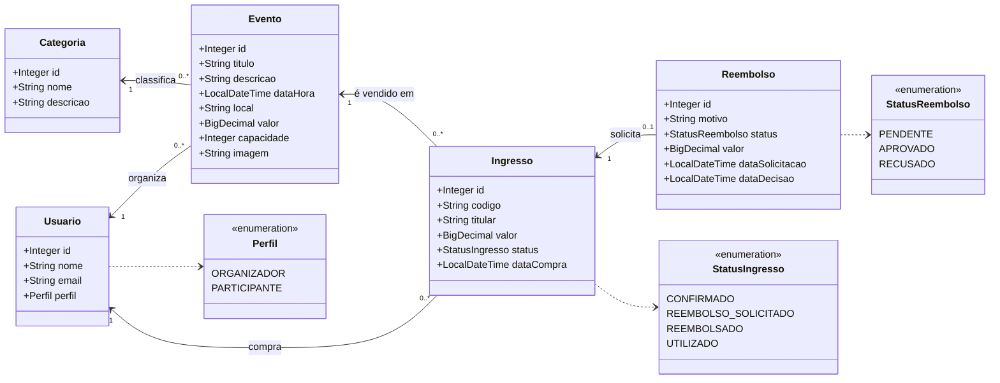

# Modelo de dados – Conecta Event

Diagrama de classes das entidades JPA do backend (o GitHub desenha o diagrama automaticamente).

## Tabelas geradas no MySQL

| Tabela | Chaves estrangeiras | Restrições |
|---|---|---|
| `usuario` | | `email` único |
| `categoria` | | `nome` único |
| `evento` | `categoria_id` → categoria, `organizador_id` → usuario | |
| `ingresso` | `evento_id` → evento, `participante_id` → usuario | `codigo` único |
| `reembolso` | `ingresso_id` → ingresso | `ingresso_id` único (1 pedido por ingresso) |

## Relacionamentos

- **Categoria 1 : N Evento** (`@ManyToOne` em `Evento.categoria`). Todo evento pertence a uma categoria.
- **Usuario 1 : N Evento** (`@ManyToOne` em `Evento.organizador`). Só usuários com perfil ORGANIZADOR podem organizar eventos.
- **Evento 1 : N Ingresso** (`@ManyToOne` em `Ingresso.evento`). A quantidade de ingressos válidos é limitada pela `capacidade` do evento.
- **Usuario 1 : N Ingresso** (`@ManyToOne` em `Ingresso.participante`). Cada participante tem no máximo um ingresso válido por evento.
- **Ingresso 1 : 0..1 Reembolso** (`@OneToOne` em `Reembolso.ingresso`). Cada ingresso pode ter no máximo um pedido de reembolso.

Os relacionamentos são mapeados só do lado "muitos" (unidirecionais). Assim, o JSON das respostas não entra em laço infinito.
